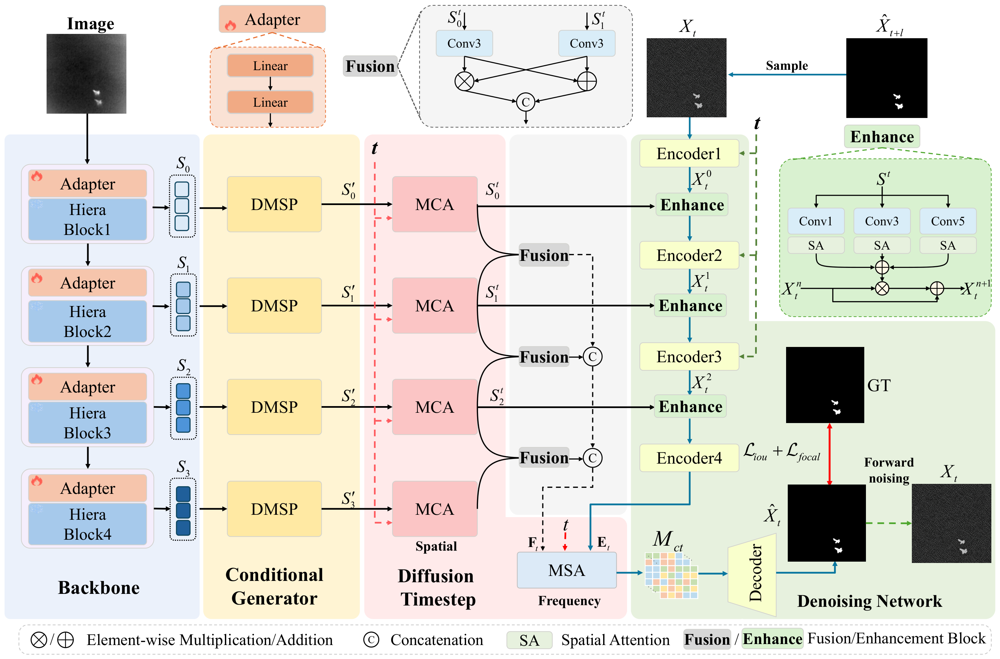
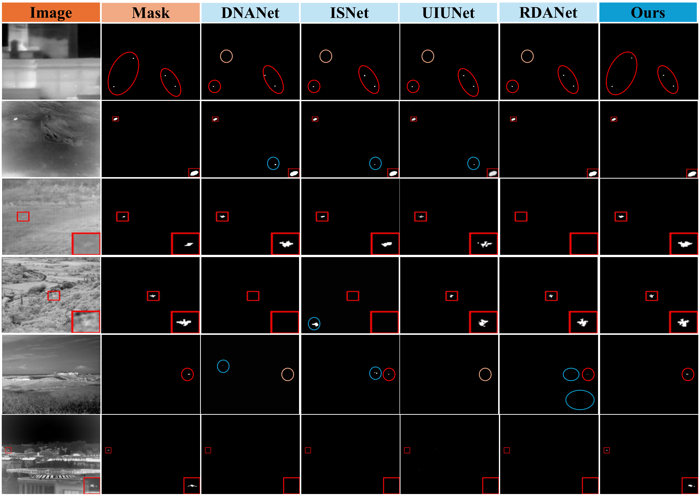
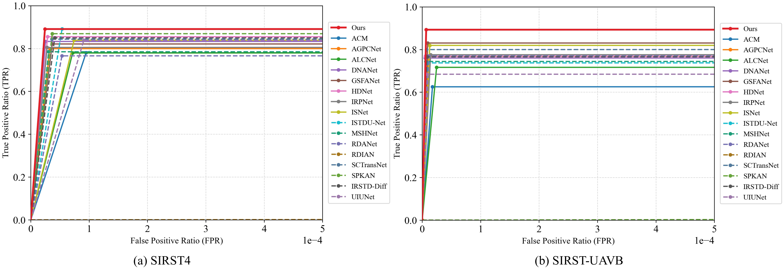

# Generating Through the Noise: Progressive Denoising Diffusion for Infrared Small Target Detection

PDDiff formulates infrared small target detection as an image-conditioned, progressive denoising process. Starting from a noisy mask, the model iteratively reconstructs target structures using spatial and frequency guidance from the infrared image.

## Overview




**Figure 3.**

## Installation

Run the following commands from the project root in a Python environment with a CUDA-compatible PyTorch installation:

```bash
python -m pip install -r requirements.txt
```

Prepare the encoder checkpoint specified by `model.params.checkpoint_path`. The existing training configurations below expect:

```text
config/sam2.1_hiera_small.pt
```

The model configuration and encoder checkpoint must match. Trained detection checkpoints are supplied separately and are passed through `--checkpoint` during evaluation.

## Dataset preparation

Organize the datasets as follows:

```text
data/
├── SIRST4/
│   ├── images/
│   ├── masks/
│   └── img_idx/
│       ├── train.txt
│       └── test.txt
└── SIRST-UAV/
    ├── images/
    ├── masks/
    └── img_idx/
        ├── train.txt
        └── test.txt
```

## Training Commend

### SIRST4

```bash
CUDA_VISIBLE_DEVICES=0 python train.py \
  --config config/irstd_sirst4_500ep_smsp_tpa_640x640.yaml \
  --results_folder results_irstd/PDDiff_SIRST4 \
  --num_epoch 500 \
  --batch_size 8 \
  --num_workers 8
```

### SIRST-UAV

```bash
CUDA_VISIBLE_DEVICES=0 python train.py \
  --config config/irstd_sirst_uav_500ep_smsp_tpa_640x640.yaml \
  --results_folder results_irstd/PDDiff_SIRST_UAV \
  --num_epoch 500 \
  --batch_size 8 \
  --num_workers 8
```

These configurations enable SMSP during training and TPA for the sampling schedule.

### Multiple GPUs

For example, train SIRST4 using two GPUs:

```bash
CUDA_VISIBLE_DEVICES=0,1 accelerate launch --multi_gpu --num_processes 2 train.py \
  --config config/irstd_sirst4_500ep_smsp_tpa_640x640.yaml \
  --results_folder results_irstd/PDDiff_SIRST4_2GPU \
  --num_epoch 500 \
  --batch_size 8 \
  --num_workers 8
```

These configurations set `split_batches: false`, so `--batch_size` is the batch size per process. Two processes with batch size 8 use a total batch size of 16 when gradient accumulation is 1. Adjust this deliberately when comparing experiments.

Add `--fp16` to enable mixed precision, or reduce `--batch_size` if GPU memory is insufficient. Use a new results directory for each experiment. The selected best checkpoint is saved as `model-best.pt`, and validation records are written to `metrics.jsonl`.

## Testing and inference

Use the same architecture configuration as the trained checkpoint. The examples below use **15 sampling steps** and save predictions and metrics to separate directories.

### SIRST4

```bash
CUDA_VISIBLE_DEVICES=0 python sample_irstd.py \
  --config config/irstd_sirst4_500ep_smsp_tpa_640x640.yaml \
  --checkpoint results_irstd/PDDiff_SIRST4/model-best.pt \
  --target_dataset SIRST4 \
  --num_sample_steps 15 \
  --batch_size 1 \
  --num_workers 4 \
  --results_folder results_irstd/PDDiff_SIRST4_test
```

### SIRST-UAV

```bash
CUDA_VISIBLE_DEVICES=0 python sample_irstd.py \
  --config config/irstd_sirst_uav_500ep_smsp_tpa_640x640.yaml \
  --checkpoint results_irstd/PDDiff_SIRST_UAV/model-best.pt \
  --target_dataset SIRST-UAV \
  --num_sample_steps 15 \
  --batch_size 1 \
  --num_workers 4 \
  --results_folder results_irstd/PDDiff_SIRST_UAV_test
```

## Visual results



**Figure 7.** Qualitative results on SIRST4 and SIRST-UAVB. Red, blue, and orange circles indicate correct detections, false alarms, and missed detections, respectively.



**Figure 10.** ROC curves on SIRST4 and SIRST-UAVB. The red **Ours** curve denotes PDDiff.
